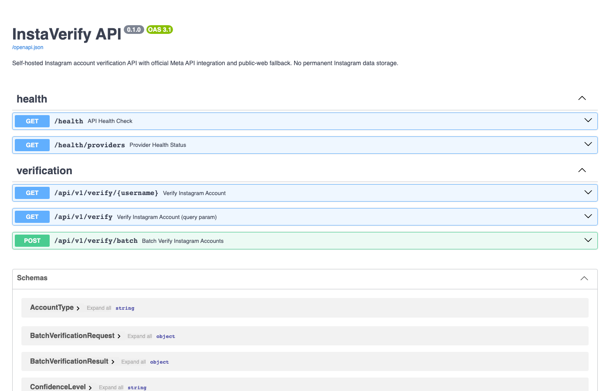
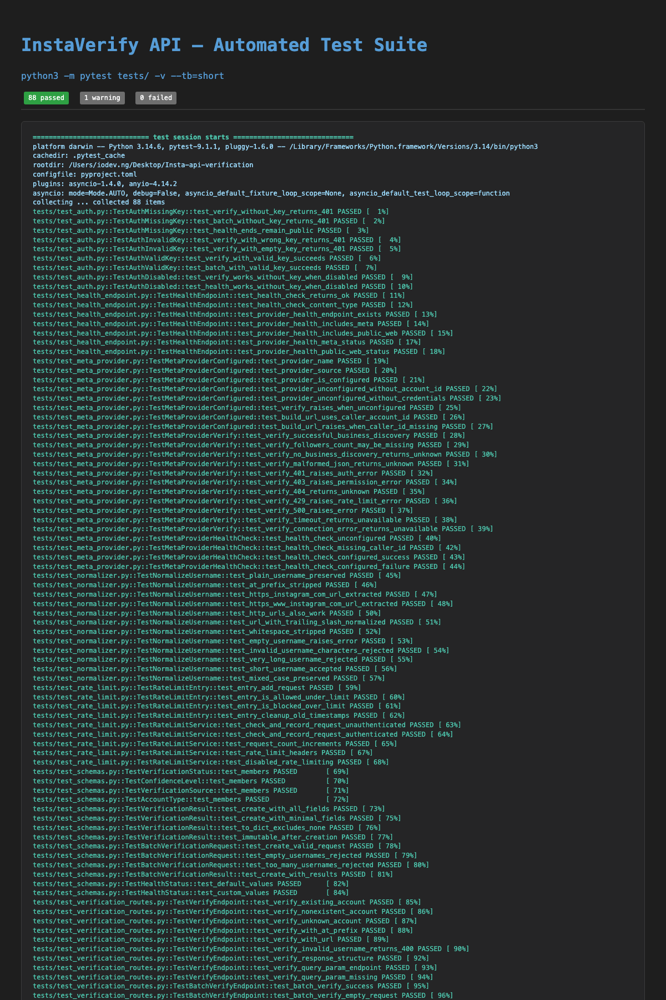
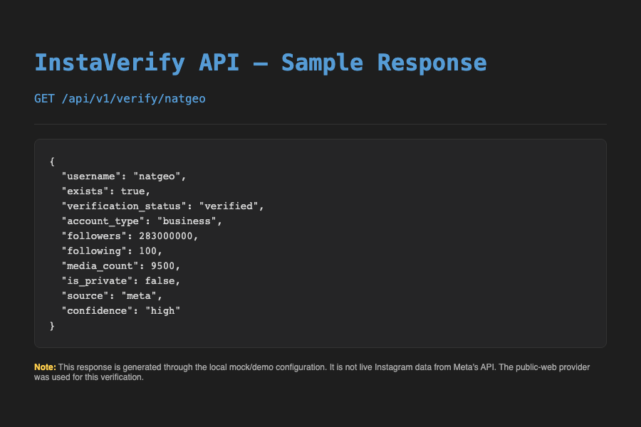

# InstaVerify API

Self-hosted Instagram account verification API with official Meta API integration and public-web fallback.

## Features

- Instagram username normalization (handles @prefix, URLs, plain usernames)
- Professional account verification via Meta Business Discovery API
- Public profile verification fallback
- Follower count when officially available from Meta API
- Batch verification endpoint
- API key authentication (env-configured)
- Rate limiting (configurable)
- Optional Redis caching (not required)
- Structured error responses
- OpenAPI documentation at `/docs`
- Docker deployment ready
- Automated tests

## Important API Limitation

> Meta's official Instagram API does not provide unrestricted lookup or follower-count access for arbitrary personal Instagram accounts. InstaVerify therefore distinguishes between information available through Meta's official API and best-effort public-web verification.

The API never fabricates results. If verification cannot be completed, it returns an inconclusive result rather than guessing.

## Quick Start

### Installation

```bash
pip install -e ".[dev]"
playwright install chromium  # For public-web provider (optional)
```

### Configuration

Copy `.env.example` to `.env` and configure:

```bash
cp .env.example .env
# Edit .env with your settings
```

Required settings for basic operation:
- No secrets required for mock/demo mode

Optional settings for production:
- `META_APP_ID`, `META_APP_SECRET`, `META_ACCESS_TOKEN` for Meta API
- `META_INSTAGRAM_ACCOUNT_ID` for Meta Business Discovery (caller's IG user ID)
- `API_KEY` for authenticated requests
- `REDIS_URL` for caching

### Running

```bash
uvicorn app.main:app --reload
```

Or with Docker:

```bash
docker compose up -d
```

### Meta Business Discovery Configuration

The Meta provider uses the [Business Discovery](https://developers.facebook.com/docs/instagram-platform/instagram-api-with-facebook-login/business-discovery) flow:

```
GET /{caller_ig_user_id}?fields=business_discovery.username({target_username}){followers_count,media_count}
```

To configure it, you need:
1. A Meta app with the Instagram product added.
2. An access token with `instagram_basic`, `instagram_manage_insights`, and `pages_read_engagement` permissions.
3. The caller's Instagram professional account ID (`META_INSTAGRAM_ACCOUNT_ID`), which is the IG user ID of the account that will perform the lookup.

You can find the caller's IG user ID via the Graph API Explorer or by querying `/{ig-user-id}` with your access token.

Important limitations:
- Business Discovery only returns data for Instagram professional (business/creator) accounts.
- Personal accounts, age-gated accounts, and accounts the caller does not have permission to query will not return a `business_discovery` object.
- The API does not provide unrestricted follower-count lookup for arbitrary personal accounts. InstaVerify never fabricates follower counts.

### API Documentation

Once running, visit:
- Swagger UI: http://localhost:8000/docs
- ReDoc: http://localhost:8000/redoc

## API Endpoints

### Health Checks

```http
GET /health
```

Response:
```json
{
    "status": "ok",
    "version": "0.1.0"
}
```

```http
GET /health/providers
```

Response:
```json
[
    {"name": "meta", "status": "configured"},
    {"name": "public_web", "status": "configured"}
]
```

### Verify Account

```http
GET /api/v1/verify/{username}
```

Parameters:
- `username`: Instagram username (supports @prefix, URLs, or plain username)

Response (account exists, verified via Meta Business Discovery):
```json
{
    "username": "bluebottle",
    "exists": true,
    "verification_status": "verified",
    "account_type": "professional",
    "followers": 267793,
    "media_count": 1205,
    "source": "meta",
    "confidence": "high"
}
```

Response (inconclusive — Meta cannot access the account):
```json
{
    "username": "someuser",
    "exists": null,
    "verification_status": "unknown",
    "source": "meta",
    "confidence": "low"
}
```

Note: Meta's Business Discovery does not return `not_found` for inaccessible accounts (personal, age-gated, or insufficient permissions). Instead it returns an inconclusive result. The public-web provider may return `not_found` for accounts confirmed not to exist.

### Batch Verification

```http
POST /api/v1/verify/batch
```

Request:
```json
{
    "usernames": ["user1", "user2", "user3"]
}
```

Response:
```json
{
    "results": [
        {"username": "user1", "exists": true, "verification_status": "verified", ...},
        {"username": "user2", "exists": false, "verification_status": "not_found", ...},
        {"username": "user3", "exists": null, "verification_status": "unknown", ...}
    ]
}
```

Maximum batch size: 50 usernames.

### Alternative Verify Endpoint

```http
GET /api/v1/verify?username={username}
```

Same functionality as `/verify/{username}` but uses query parameter.

## Verification States

The API uses structured verification states rather than simple true/false:

| Status | Description |
|--------|-------------|
| `verified` | Account confirmed to exist |
| `not_found` | Account confirmed not to exist |
| `unknown` | Could not determine (inconclusive) |
| `restricted` | Verification restricted (e.g., rate limited) |
| `unavailable` | Verification service unavailable |

## Confidence Levels

| Level | Description |
|-------|-------------|
| `high` | Official Meta API data |
| `medium` | Public web verification |
| `low` | Inconclusive or ambiguous |

## Provider System

The API uses a provider-based architecture:

1. **MetaProvider**: Official Meta Instagram Business Discovery API
2. **PublicWebProvider**: Controlled public web verification (Playwright)

Additional providers can be added without changing the API.

## Testing

```bash
pytest
pytest --cov=app --cov-report=term-missing
```

## Type Checking

```bash
mypy app/
```

## Linting

```bash
ruff check .
ruff format .
```

## Project Structure

```
instaverify-api/
├── app/
│   ├── main.py              # FastAPI application entry point
│   ├── config.py            # Environment-based configuration
│   ├── api/
│   │   ├── routes/
│   │   │   ├── health.py    # Health check endpoints
│   │   │   ├── verify.py    # Verification endpoints
│   │   │   └── errors.py    # Custom exception handlers
│   ├── providers/
│   │   ├── base.py          # Provider interface & implementations
│   ├── services/
│   │   ├── normalizer.py    # Username normalization
│   │   └── verifier.py      # Verification service orchestration
│   └── schemas/
│       └── response.py      # Pydantic response models
├── tests/
│   ├── test_normalizer.py
│   ├── test_schemas.py
│   ├── test_health_endpoint.py
│   └── test_verification_routes.py
├── .env.example
├── pyproject.toml
├── requirements.txt
└── README.md
```

## Security

- API keys via `X-API-Key` header (env-configured)
- Rate limiting per IP and per API key
- Input validation on all endpoints
- No credentials logged
- CORS configurable
- No permanent Instagram data storage
- Proxy trust configuration for rate limiting behind reverse proxies

## Proxy Configuration

When deploying behind a reverse proxy (nginx, AWS ALB, etc.):

1. Set `TRUST_PROXY_HEADERS=true` in your environment
2. Configure your proxy to set `X-Forwarded-For` header
3. Rate limiting will use the original client IP from the proxy header

**Important:** Only enable this when behind a **trusted** reverse proxy. Otherwise, attackers can spoof their IP by setting the header directly.

When `TRUST_PROXY_HEADERS=false` (default), rate limiting uses the direct connection IP.

## Environment Variables

See `.env.example` for all configuration options.

## Docker

### Prerequisites

- Docker and Docker Compose installed
- Chromium browser installed via Playwright (included in Dockerfile)

### Quick Start

```bash
# Copy environment template
cp .env.example .env

# Edit .env with your configuration
# At minimum, set API_KEY for production

# Start services
docker compose up -d
```

### Services

- **api**: InstaVerify API (FastAPI + Playwright Chromium)
- **redis**: Optional Redis for caching (disabled by default)

### Configuration

Environment variables can be set in `.env` file or directly in `docker-compose.yml`.

Key variables:
- `API_KEY`: API key for authentication (required for production)
- `META_APP_ID`, `META_APP_SECRET`, `META_ACCESS_TOKEN`: Meta API credentials
- `META_INSTAGRAM_ACCOUNT_ID`: Caller's Instagram professional account ID for Business Discovery
- `META_API_VERSION`: Meta Graph API version (default: v19.0)
- `RATE_LIMIT_PER_MINUTE`: Requests per minute per IP (default: 100)
- `RATE_LIMIT_PER_HOUR`: Requests per hour per API key (default: 1000)
- `TRUST_PROXY_HEADERS`: Trust proxy headers (default: false)
- `PUBLIC_WEB_ENABLED`: Enable public web verification (default: true)

### Stopping

```bash
docker compose down
```

To also remove volumes (clears Redis data):

```bash
docker compose down -v
```

## GitHub Actions CI

The repository includes a GitHub Actions workflow (`.github/workflows/ci.yml`) that:

1. Installs dependencies
2. Installs Playwright Chromium browser
3. Runs Ruff linting
4. Runs mypy type checking
5. Runs pytest test suite
6. Builds Docker image

Push to `main` or `develop` branches, or open a pull request to trigger the pipeline.

## Local Development

### Installation

```bash
pip install -e ".[dev]"
playwright install chromium  # For public-web provider (optional)
```

### Running

```bash
uvicorn app.main:app --reload
```

### API Documentation

Once running, visit:
- Swagger UI: http://localhost:8000/docs
- ReDoc: http://localhost:8000/redoc

## Testing

```bash
pytest
pytest --cov=app --cov-report=term-missing
```

## Type Checking

```bash
mypy app/
```

## Linting

```bash
ruff check .
ruff format .
```

## Project Structure

```
instaverify-api/
├── app/
│   ├── main.py              # FastAPI application entry point
│   ├── config.py            # Environment-based configuration
│   ├── api/
│   │   ├── routes/
│   │   │   ├── health.py    # Health check endpoints
│   │   │   ├── verify.py    # Verification endpoints
│   │   │   └── errors.py    # Custom exception handlers
│   │   └── dependencies.py # API key authentication
│   ├── providers/
│   │   ├── base.py          # Provider interface & implementations
│   │   ├── meta.py          # Meta Graph API provider
│   │   └── public_web.py    # Playwright-based public web provider
│   ├── services/
│   │   ├── normalizer.py    # Username normalization
│   │   ├── verifier.py      # Verification service orchestration
│   │   └── rate_limit.py    # In-memory rate limiting
│   └── schemas/
│       └── response.py      # Pydantic response models
├── tests/
│   ├── test_normalizer.py
│   ├── test_schemas.py
│   ├── test_health_endpoint.py
│   ├── test_verification_routes.py
│   ├── test_meta_provider.py
│   ├── test_auth.py
│   └── test_rate_limit.py
├── .github/
│   └── workflows/
│       └── ci.yml           # GitHub Actions CI pipeline
├── Dockerfile               # Multi-stage build with Playwright
├── docker-compose.yml       # API + optional Redis
├── .dockerignore
├── .env.example
├── pyproject.toml
├── requirements.txt
└── README.md
```

## Development

This is a greenfield project using:
- Python 3.11+
- FastAPI
- Pydantic v2
- Pytest
- Playwright (optional, for public-web provider)
- Ruff (linting)
- Mypy (type checking)

## Portfolio Screenshots

The following screenshots demonstrate the InstaVerify API in action:

### API Documentation (Swagger UI)



The Swagger UI at `/docs` provides interactive API documentation for all endpoints:
- `GET /health` — Health check
- `GET /health/providers` — Provider status
- `GET /api/v1/verify/{username}` — Verify a single account
- `GET /api/v1/verify?username={username}` — Verify via query parameter
- `POST /api/v1/verify/batch` — Batch verification (up to 50 usernames)

### Automated Test Suite



The project includes a comprehensive test suite with 88 passing tests covering:
- Authentication (API key verification)
- Health endpoints
- Meta provider (Business Discovery flow)
- Username normalization
- Rate limiting
- Response schemas
- Verification routes (single, query param, batch)

### Sample API Response



Example response from `GET /api/v1/verify/natgeo`. This response is generated through the local mock/demo configuration and is not live Instagram data from Meta's API.

## License

MIT

